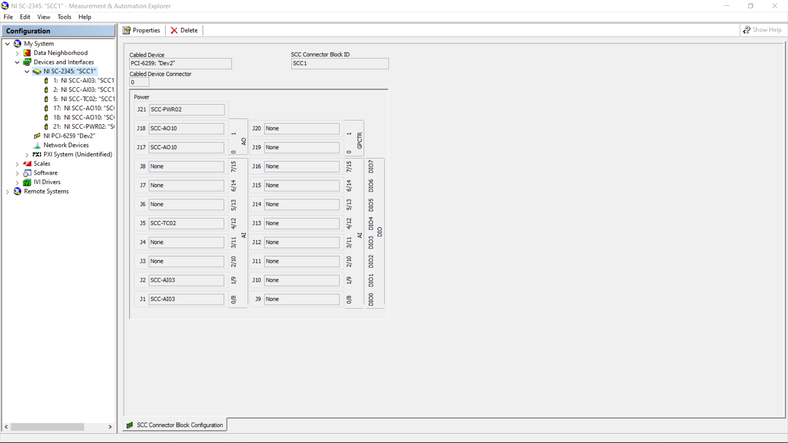
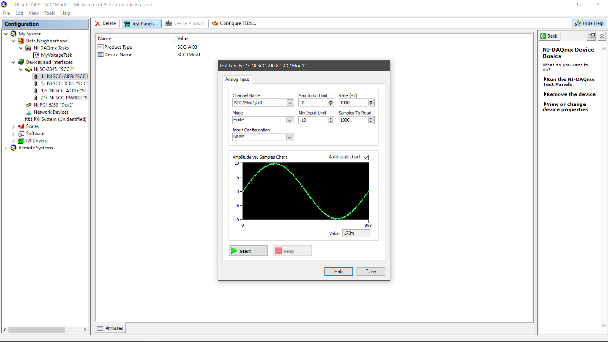
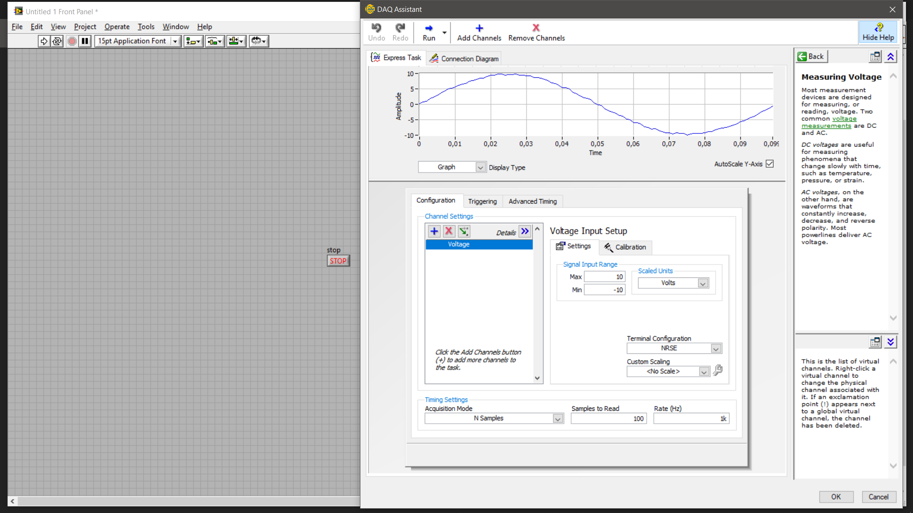
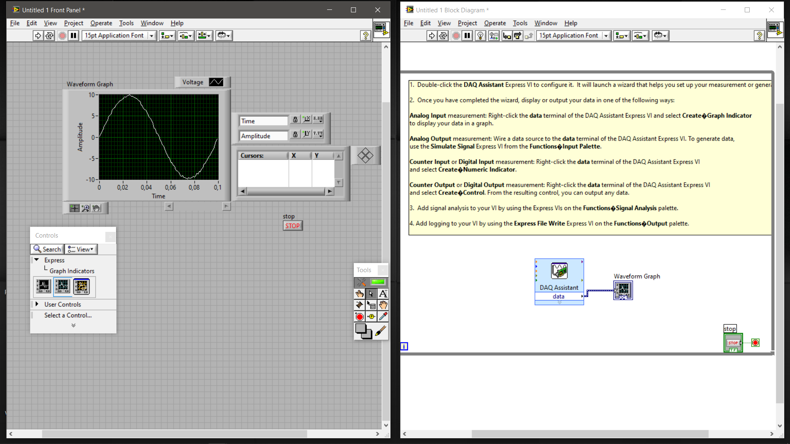

# Măsurarea tensiunii cu LabVIEW

---

## 🇷🇴 Română

### Descriere

Acest repository prezintă un proiect realizat în **LabVIEW**, având ca obiectiv configurarea unui sistem de achiziție analogică și vizualizarea unui semnal de tensiune.

Proiectul utilizează instrumente NI-DAQmx și DAQ Assistant pentru configurarea intrării analogice, achiziția datelor și reprezentarea grafică a semnalului.

Proiectul reprezintă un exercițiu practic de instrumentație, măsurători electrice și achiziție de date.

## 2. Obiective și competențe demonstrate

- Configurarea unui dispozitiv de achiziție NI în NI Measurement & Automation Explorer (NI MAX).
- Configurarea unei intrări analogice pentru măsurarea tensiunii.
- Utilizarea NI-DAQmx și DAQ Assistant.
- Achiziția și vizualizarea semnalelor în LabVIEW.
- Lucrul cu panoul frontal și diagrama bloc.

## 3. Fluxul de lucru

Proiectul urmărește următoarele etape:

1. **Configurarea hardware-ului:** identificarea și verificarea dispozitivului NI în NI MAX.
2. **Configurarea achiziției:** setarea unei intrări analogice de tensiune folosind DAQ Assistant.
3. **Achiziția datelor:** preluarea semnalului prin intermediul sistemului de achiziție.
4. **Vizualizarea:** reprezentarea grafică a semnalului pe panoul frontal LabVIEW.
5. **Verificarea:** verificarea configurației canalului și a parametrilor de achiziție în funcție de hardware-ul utilizat.

## 4. Capturi de ecran

### Configurarea dispozitivului în NI MAX



### Testarea intrării analogice



### Configurarea DAQ Assistant



### Panoul frontal și diagrama bloc LabVIEW



## 5. Cerințe software și hardware

- LabVIEW, într-o versiune compatibilă cu fișierele VI.
- Driver NI-DAQmx compatibil cu versiunea LabVIEW instalată.
- Dispozitiv de achiziție NI compatibil pentru efectuarea măsurătorilor fizice.
- Conexiuni hardware corespunzătoare.

## 6. Cum se deschide proiectul

1. Instalați LabVIEW și NI-DAQmx.
2. Conectați dispozitivul de achiziție și verificați configurarea acestuia în NI MAX.
3. Descărcați sau clonați repository-ul.
4. Deschideți `L10.vi` sau `L10_1.vi` în LabVIEW.
5. Verificați canalul fizic și parametrii de achiziție.
6. Rulați instrumentul virtual și urmăriți semnalul pe panoul frontal.

În lipsa unui dispozitiv NI compatibil, fișierele pot fi inspectate în LabVIEW, însă achiziția fizică nu poate fi validată.

## 7. Structura proiectului

```text
Masurarea-Tensiunii-LabVIEW/
│
├── L10.vi
├── L10_1.vi
├── README.md
│
├── Images/
│   ├── 01-configurare-dispozitiv.png
│   ├── 02-test-panels-masurare.png
│   ├── 03-configurare-daq-assistant.png
│   └── 04-panou-frontal-si-diagrama.png
│
└── documentatie/
    ├── documentatie.docx
    └── documentatie.pdf
```

---

# Voltage Measurement with LabVIEW

## 🇬🇧 English

### Description

This repository presents a **LabVIEW project** focused on configuring an analog data acquisition system and visualizing a voltage signal.

The project uses NI-DAQmx and DAQ Assistant to configure analog input channels, acquire measurement data, and display the resulting waveform.

It represents a practical exercise in instrumentation, electrical measurements, and data acquisition.

## 2. Objectives and Demonstrated Skills

- Configuring an NI data acquisition device using NI Measurement & Automation Explorer (NI MAX).
- Setting up analog voltage input channels.
- Working with NI-DAQmx and DAQ Assistant.
- Acquiring and visualizing signals in LabVIEW.
- Working with LabVIEW front panels and block diagrams.

## 3. Workflow

The project follows these main stages:

1. **Hardware configuration:** identifying and verifying the NI device in NI MAX.
2. **Acquisition setup:** configuring an analog voltage input using DAQ Assistant.
3. **Data acquisition:** acquiring the signal through the data acquisition system.
4. **Visualization:** displaying the waveform on the LabVIEW front panel.
5. **Verification:** checking the physical channel configuration and acquisition parameters according to the available hardware.

## 4. Screenshots

### Device Configuration in NI MAX


### Analog Input Testing


### DAQ Assistant Configuration


### LabVIEW Front Panel and Block Diagram


## 5. Software and Hardware Requirements

- LabVIEW version compatible with the supplied VI files.
- NI-DAQmx driver compatible with the installed LabVIEW version.
- Compatible NI data acquisition hardware for physical measurements.
- Appropriate hardware connections.

## 6. How to Open the Project

1. Install LabVIEW and NI-DAQmx.
2. Connect the data acquisition device and verify its configuration in NI MAX.
3. Download or clone this repository.
4. Open `L10.vi` or `L10_1.vi` in LabVIEW.
5. Check the physical input channel and acquisition parameters.
6. Run the virtual instrument and observe the signal on the front panel.

Without compatible NI hardware, the files can be inspected in LabVIEW, but physical data acquisition cannot be validated.

## 7. Repository Structure

```text
Masurarea-Tensiunii-LabVIEW/
│
├── L10.vi
├── L10_1.vi
├── README.md
│
├── Images/
│   ├── 01-configurare-dispozitiv.png
│   ├── 02-test-panels-masurare.png
│   ├── 03-configurare-daq-assistant.png
│   └── 04-panou-frontal-si-diagrama.png
│
└── documentatie/
    ├── documentatie.docx
    └── documentatie.pdf
```

---

## 👤 Autor / Author

**IonutD**
